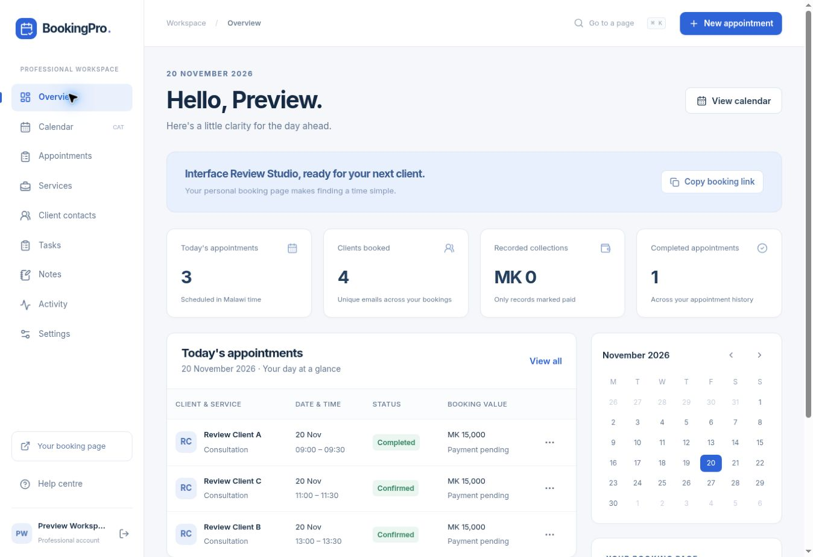

# BookingPro interface completion — 20 November 2026

## Delivered experience

The public site and private workspace now share a coherent visual system, responsive layouts, accessible controls, error recovery and real data. The public home remains public after sign-in; clients are no longer forced into professional onboarding.

| Area | Implemented interface and behaviour |
| --- | --- |
| Public site | New landing page, professional directory with search/specialty filtering, shared navigation/footer, factual business/about/help/contact/privacy/terms pages and a useful 404 |
| Account access | Separate client/professional entry choices, sign-in/registration modes, password visibility, validation, pending/error feedback and role-aware destinations |
| Onboarding | Three stages for profile, working hours and first service; atomic save; immediate owned-provider context |
| Workspace | Persistent desktop sidebar, accessible mobile drawer, keyboard page search, role-specific navigation, account sign-out and public booking-page links |
| Overview | Stored appointment totals, unique booked client emails, actual recorded collections, completed counts, today's appointments, tasks and calendar |
| Calendar and appointments | Month/agenda views, searchable/filterable appointment table, details, completion, cancellation and availability-backed rescheduling |
| Services | Create, edit and archive services; owner checks; existing booking values/history retained |
| Client workspace | Upcoming/past/all bookings, private details, client-owned future cancellation/rescheduling and contact links |
| Booking and confirmation | Two-step service/date/time/details journey; actual provider working days; fresh availability; future-time validation; stored confirmation, printing and UTC-correct ICS download |
| Tasks and notes | Search/filter, create/edit/delete confirmation, task completion and priority, due dates, note categories and important notes |
| Contacts and activity | Actual appointment contacts with email/phone links; a chronological view of saved appointments/tasks with current statuses |
| Settings | Public profile, website and working-hour/day editing, with separate account/security information |
| Reviews | Published records with actual recorded dates; no invented verification badges or review-submission promises |

Fake support contacts, fake message submissions, fabricated social proof, dead footer links, unsupported payment/reminder claims and the permanent notification dot were removed. Contacts open the device's email/phone applications; they are not an in-app chat service. Activity is derived from stored records and is not a separate email/push notification delivery system.

## Verification

- TypeScript and production build pass.
- HTTP/query/security regressions: 24/24 pass.
- PostgreSQL 18.6 integration tests: 15/15 pass. The two added cases exercise real client cancellation/rescheduling across independent workers and service editing/archival while preserving original booking value and status management.
- Local browser: public discovery, selecting an available service/date/time, guest booking submission and saved confirmation pass.
- Isolated local browser fixture: provider workspace, service creation/readback, calendar rescheduling/readback, task creation/readback, settings controls, client appointment cards, client cancellation, and complete three-step provider onboarding pass.
- Calendar download checked in the browser: a 10:00 Malawi appointment exports `DTSTART:20261120T080000Z` in a valid VCALENDAR document.
- Responsive browser check at 454 CSS pixels: mobile navigation drawer and notes navigation pass; document scroll width remains within viewport width.
- Initial production JavaScript entry is approximately 286 KB, down from 1,075 KB. Pages load in separate route chunks.

Private visual checks use `integration/ui-fixture.ts`, a development-only, in-memory server with an injected test identity and fictional data. It refuses a database connection and is not imported into either production bundle. The checked default `dev` script continues to use the real application authentication adapter. `npm run dev:fixture -- --client` selects the client visual-review identity. Browser fixture results do not certify live sign-in; real authentication and database ownership are separately covered by the PostgreSQL integration suite.

## Operational boundaries

No schema change or production data migration is required for this interface revision. The existing Neon production and preview isolation are preserved. Production deployment verification is recorded on PR #5 after publishing the exact application revision.

Email ownership verification/recovery, automated email/SMS/push delivery, in-app chat, payment settlement, professional credential verification and independent backup restoration remain separate operational work. The interface does not claim these services are active. GitHub-hosted runner startup remains a separate execution issue from the locally passing checks. No merge is performed by this interface work.
